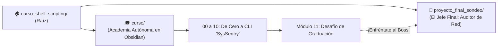

# 🚀 Curso Shell Scripting Basics en Linux & Proyecto "Final Boss"

¡Bienvenido al repositorio! Este espacio está diseñado como un ecosistema completo de dos niveles: una **academia formativa autónoma en Obsidian** para aprender scripting desde cero, y un **proyecto del mundo real (`sondeo.sh`)** que actúa como el "Jefe Final" (Final Boss) para consolidar tu maestría técnica.

---

## 🏛️ Las Dos Grandes Áreas del Repositorio



| Componente | Carpeta | Descripción |
| :--- | :--- | :--- |
| 🎓 **La Academia de Scripting** | [[curso/00 - MOC - Fundamentos de Shell Scripting|curso/]] | Curso modular de primer nivel optimizado para Obsidian, con 11 lecciones, MOC interactivo, canvas visual y laboratorios prácticos. **100% autónomo**. |
| 👾 **El Final Boss** | [[proyecto_final_sondeo/README|proyecto_final_sondeo/]] | El script real de auditoría de red (`sondeo.sh`) con su propio [[proyecto_final_sondeo/README|README.md]] independiente. El reto que el estudiante analiza, debugea y mejora para graduarse. |

---

## 📁 Mapa de Carpetas y Organización

```text
curso_shell_scripting/
├── README.md                      # 📖 Portada y mapa general del repositorio
│
├── curso/                         # 🎓 BÓVEDA AUTÓNOMA PARA OBSIDIAN
│   ├── 00 - MOC - Fundamentos de Shell Scripting.md   # 🗺️ Índice MOC interactivo
│   ├── Ruta de Aprendizaje.canvas                     # 🎨 Pizarra visual interactiva infinita
│   │
│   ├── fase_1_cimientos/          # 📚 Fase I: Cimientos y Filosofía UNIX
│   │   ├── 01 - El Modelo Mental de la Shell de Linux.md
│   │   └── 02 - El Flujo de Datos UNIX y Redirecciones.md
│   │
│   ├── fase_2_lenguaje/           # ⚙️ Fase II: El Motor del Lenguaje Bash
│   │   ├── 03 - Variables, Sintaxis y la Regla de Oro.md
│   │   ├── 04 - Parámetros Posicionales y Argumentos.md
│   │   └── 05 - Códigos de Salida y Estructuras Condicionales.md
│   │
│   ├── fase_3_automatizacion/     # 🔄 Fase III: Automatización, Estructura y Robustez
│   │   ├── 06 - Bucles y Automatización Masiva.md
│   │   ├── 07 - Funciones y Modularidad Limpia.md
│   │   └── 08 - Programación Defensiva y Debug.md
│   │
│   ├── fase_4_proyectos/          # 🏆 Fase IV: Práctica y Consolidación
│   │   ├── 09 - Proyecto Integrador - Creando tu CLI.md
│   │   ├── 10 - Glosario Maestro y Próximos Pasos.md
│   │   └── 11 - Desafío Maestro - Leyendo sondeo.sh con Superpoderes.md
│   │
│   └── laboratorios/              # 🧪 Sandbox de Pruebas Prácticas
│       ├── README.md              # Instrucciones del laboratorio
│       ├── ejercicio_debug.sh     # Reto "Encuentra y repara los 5 bugs"
│       ├── logs_simulados.log     # Registro real para filtros y pipes
│       └── servidores_prueba.txt  # Lista de hosts para bucles de red
│
└── proyecto_final_sondeo/         # 👾 EL JEFE FINAL (PROYECTO GUIADO BLOQUE A BLOQUE)
    ├── README.md                  # 📖 Presentación de la misión y cómo trabajar
    ├── GUIA_CONSTRUCCION.md       # 📘 Tutorial guiado paso a paso en 6 bloques
    ├── esqueleto_starter.sh       # 🛠️ Plantilla comentada con tareas TODO para programar
    └── sondeo.sh                  # 🛡️ Solución terminada de referencia
```

---

## 🚀 Cómo Empezar

### Opción 1: Si vienes a Aprender Scripting desde Cero
1. Abre **Obsidian**.
2. Selecciona **"Open folder as vault"** y abre esta carpeta raíz (`/home/mikha/Escritorio/curso_shell_scripting`) o directamente la carpeta `curso/`.
3. Abre **`00 - MOC - Fundamentos de Shell Scripting`** o explora la pizarra visual **`Ruta de Aprendizaje.canvas`**.
4. Sigue cada módulo paso a paso haciendo los experimentos en tu terminal y completando las casillas interactiva `- [ ]`.

### Opción 2: Si vienes directamente a usar el Final Boss (`sondeo.sh`)
1. Entra en el directorio del proyecto:
   ```bash
   cd proyecto_final_sondeo
   ```
2. Lee las instrucciones de uso en su **[[proyecto_final_sondeo/README|README.md]]**.
3. Ejecuta la auditoría con privilegios de root:
   ```bash
   sudo ./sondeo.sh
   ```

---

## 🎯 El Desafío de Graduación: Derrotar al Final Boss

Cuando alcances el **Módulo 11**, se te encomendará la misión suprema del curso:
1. **Comprender:** Abrir [[sondeo.sh]] y entender cada una de sus 257 líneas (subredes, Here-Docs con Python, tuberías de ordenación octeto por octeto).
2. **Debugear:** Correr el script en modo traza visual (`sudo bash -x ./sondeo.sh`) para inspeccionar la sustitución de comandos en tiempo real.
3. **Mejorar:** Modificar el Boss agregando tus propias funciones (como un cronómetro con `$SECONDS` o un selector de modo rápido `--fast`).
