---
tags:
  - curso/indice
  - moc
  - bash
  - linux
  - scripting/fundamentos
tipo: mapa_de_contenido
dificultad: principiante
version: 2.0
---

# 🚀 Fundamentos de Shell Scripting: De Cero a Creador en Linux

> [!abstract] Bienvenido a tu Vault de Aprendizaje en Obsidian
> Este curso no es una lista de comandos para memorizar ni un tutorial improvisado. Es una **ruta formativa de primer nivel** diseñada para que construyas un **modelo mental sólido como una roca** sobre cómo piensa Linux, cómo se comunican los procesos y cómo escribir scripts elegantes, robustos y profesionales desde tu primera línea de código.

---

## 🎯 ¿Qué lograrás al finalizar este curso?

Al terminar este recorrido, no volverás a copiar y pegar scripts a ciegas de internet. Serás capaz de:
1. **Entender qué ocurre detrás de cada carácter** en la terminal (`$`, `>`, `|`, `""`, `[[]]`).
2. **Manipular flujos de datos** conectando herramientas del sistema como si fueran piezas de LEGO.
3. **Escribir código defensivo** que maneje errores sin colapsar tu sistema operativo.
4. **Construir tus propias herramientas de línea de comandos (CLI)** reutilizables e interactivas.

---

## 🧭 Plan de Estudios y Rastreador de Progreso

Aprovecha el modo de lectura o Live Preview de Obsidian (`Ctrl + E`) para marcar las casillas conforme avances:

```mermaid
flowchart TD
    M0["00 - MOC: Plan de Estudios"] --> M1["01 - El Modelo Mental de la Shell"]
    M1 --> M2["02 - El Flujo de Datos y Redirecciones"]
    M2 --> M3["03 - Variables y Reglas de Sintaxis"]
    M3 --> M4["04 - Parámetros y Argumentos CLI"]
    M4 --> M5["05 - Códigos de Salida y Condicionales"]
    M5 --> M6["06 - Bucles y Automatización Masiva"]
    M6 --> M7["07 - Funciones y Código Modular"]
    M7 --> M8["08 - Programación Defensiva y Debug"]
    M8 --> M9["09 - Proyecto Integrador: Tu CLI"]
    M9 --> M10["10 - Glosario Maestro y Cheat Sheet"]

    classDef active fill:#1a365d,stroke:#63b3ed,stroke-width:2px;
    class M0 active;
```

### 📚 Fase I: Cimientos y Filosofía UNIX (`fase_1_cimientos/`)
- [ ] **[[01 - El Modelo Mental de la Shell de Linux]]**: Qué es la shell, el ciclo de vida de un comando, permisos, el Shebang y tu primer script ejecutable.
- [ ] **[[02 - El Flujo de Datos UNIX y Redirecciones]]**: Canales estándar (`stdin`, `stdout`, `stderr`), el agujero negro `/dev/null`, pipes (`|`) y filtros esenciales (`grep`, `wc`, `head`, `tail`).

### ⚙️ Fase II: El Motor del Lenguaje Bash (`fase_2_lenguaje/`)
- [ ] **[[03 - Variables, Sintaxis y la Regla de Oro]]**: Tipos de datos, la regla del espacio en blanco, el dilema de las comillas (`""` vs `''`), sustitución de comandos `$(...)` y aritmética `$((...))`.
- [ ] **[[04 - Parámetros Posicionales y Argumentos]]**: Cómo hacer scripts interactivos y dinámicos, `$1` a `$9`, variables mágicas (`$#`, `$@`, `$?`), expansión `${VAR:-default}` y lectura con `read`.
- [ ] **[[05 - Códigos de Salida y Estructuras Condicionales]]**: La lógica invertida de UNIX (`0 = Éxito`), comparadores modernos `[[ ... ]]`, evaluación de archivos y operadores lógicos `&&` y `||`.

### 🔄 Fase III: Automatización, Estructura y Robustez (`fase_3_automatizacion/`)
- [ ] **[[06 - Bucles y Automatización Masiva]]**: Bucles `for` (rangos, listas, archivos) y `while` (procesamiento seguro de archivos línea por línea con `IFS=`).
- [ ] **[[07 - Funciones y Modularidad Limpia]]**: Creación de funciones, la importancia crítica de `local`, retorno de valores, diseño de librerías y mensajes coloreados ANSI.
- [ ] **[[08 - Programación Defensiva y Debug]]**: El escudo `set -euo pipefail`, limpieza automática con `trap` al cancelar con `Ctrl+C` y depuración paso a paso con `bash -x`.

### 🏆 Fase IV: Práctica y Consolidación (`fase_4_proyectos/`)
- [ ] **[[09 - Proyecto Integrador - Creando tu CLI]]**: Construcción paso a paso de una herramienta real: **SysSentry** (monitor, backup y diagnóstico interactivo).
- [ ] **[[10 - Glosario Maestro y Próximos Pasos]]**: Chuleta de referencia rápida de sintaxis y hoja de ruta para continuar tu viaje (Python, Cron, Systemd).
- [ ] **[[11 - Desafío Maestro - Leyendo sondeo.sh con Superpoderes]]**: 👾 **El Jefe Final (Final Boss):** Entrar a la carpeta `proyecto_final_sondeo/`, diseccionar las 257 líneas de `sondeo.sh`, debugearlo en vivo con `bash -x` y agregarle tus propias mejoras de código.

---

## 🎨 Recursos y Herramientas del Curso

1. 🗺️ **Pizarra Visual Interactiva:** Abre **[[Ruta de Aprendizaje.canvas|Ruta de Aprendizaje (Canvas)]]** para navegar el curso como un mapa mental gráfico arrastrable.
2. 🧪 **Entorno de Pruebas (Sandbox):** Explora la carpeta `laboratorios/` con archivos de prueba reales (`logs_simulados.log`, `servidores_prueba.txt`) y un script con bugs intencionales (`ejercicio_debug.sh`) para practicar.

---

## 💡 Cómo Estudiar este Curso en Obsidian

> [!tip] 3 Hábitos para un Aprendizaje Exponencial
> 1. **No solo leas, digita:** Cada módulo tiene una sección de **🧪 Laboratorio Práctico**. Escribe los comandos en tu terminal tú mismo, experimenta y equivócate.
> 2. **Usa el Plegado de Preguntas:** Al final de cada lección hay preguntas de autoevaluación plegadas (`> [!question]-`). Respóndelas en tu mente antes de hacer clic para ver la solución.
> 3. **Observa la Vista de Grafo (`Ctrl + G`):** Mira cómo todos los conceptos se vinculan bidireccionalmente entre sí.

---

### 🚀 Comienza Ahora
➡️ Abre el primer módulo: **[[01 - El Modelo Mental de la Shell de Linux|Módulo 1: El Modelo Mental de la Shell de Linux ➡️]]**
