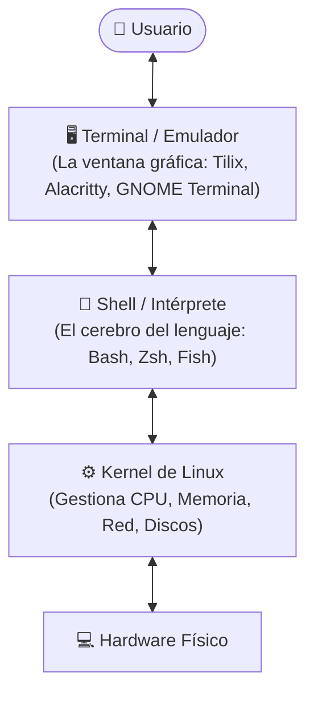

---
tags:
  - curso/modulo01
  - modelo_mental
  - linux/arquitectura
  - bash/inicio
modulo: 1
tiempo_estimado: 15 min
---

# 🧠 Módulo 1: El Modelo Mental de la Shell de Linux

[[00 - MOC - Fundamentos de Shell Scripting|🏠 Inicio (MOC)]] • [[02 - El Flujo de Datos UNIX y Redirecciones|Siguiente Módulo ➡️]]

---

## 🎯 Objetivo de este Módulo
Construir un modelo mental claro y sin confusiones sobre qué es la Shell, cómo se relaciona con el Kernel y la Terminal, cómo Linux localiza un comando en el sistema y cómo escribir, dar permisos y ejecutar tu primer script profesional.

---

## 1. Desmitificando Términos: Las Capas de Linux

Muchos principiantes usan indistintamente las palabras *Terminal*, *Consola* y *Shell*. Son cosas completamente distintas:



1. **La Terminal (La Ventana):** Es solo el programa gráfico que dibuja letras en pantalla y captura lo que tecleas.
2. **La Shell (El Intérprete):** Es un programa traductor. Lee el texto que escribes, lo interpreta y le pide al Kernel que ejecute tareas. En Linux, la shell estándar por excelencia es **Bash** (*Bourne Again Shell*).
3. **El Kernel (El Núcleo):** Es el corazón del sistema operativo que habla directamente con el procesador, la memoria RAM y el disco.

> [!info] ¿Qué es un Script realmente?
> Un script de Bash no es más que un archivo de texto plano donde escribes una serie de comandos de la shell, uno tras otro, para que se ejecuten automáticamente en secuencia, exactamente igual que si los tecleases a mano a toda velocidad.

---

## 2. El Ciclo de Vida de un Comando

Cuando escribes `ls -l /home` y pulsas `Enter`, la Shell hace 4 cosas en milisegundos:

```text
[ Entrada de texto ] ──> 1. Tokenización (Separa comando, opciones y argumentos)
                     ──> 2. Búsqueda en el $PATH (Encuentra el archivo ejecutable)
                     ──> 3. Fork & Exec (Crea un nuevo proceso en el Kernel)
                     ──> 4. Captura del código de salida (0 si tuvo éxito)
```

### ¿Cómo sabe Linux dónde vive `ls`? La variable `$PATH`
Linux no busca en todo el disco duro; busca únicamente en las carpetas listadas en la variable de entorno `$PATH`.

> [!example] Inspecciona tu propio `$PATH`
> Ejecuta en tu terminal:
> ```bash
> echo "$PATH"
> ```
> Verás una lista de rutas separadas por dos puntos (`:`), como `/usr/local/bin:/usr/bin:/bin`. Cuando ejecutas `nmap`, Bash revisa esas carpetas en orden hasta encontrar un archivo ejecutable con ese nombre.

Para averiguar dónde vive un comando y de qué tipo es:
```bash
type -a ls       # Te dirá si es un alias o un binario en /usr/bin/ls
command -v date  # Te muestra la ruta exacta (/usr/bin/date)
```

---

## 3. Anatomía del Primer Script

Crea un archivo llamado `primer_script.sh`. Todo buen script comienza con 2 elementos sagrados:

```bash
#!/usr/bin/env bash

# Esto es un comentario explicativo
echo "¡Hola desde mi primer script automatizado!"
```

### El Shebang (`#!/usr/bin/env bash`)
- Los dos primeros caracteres `#!` le dicen al Kernel: *"Este archivo no es un binario compilado (como C o Go); ábrelo usando el intérprete que te indico a la derecha"*.
- **¿Por qué `/usr/bin/env bash` y no `/bin/bash`?**  
  Usar `/usr/bin/env bash` busca la ruta dinámica donde esté instalado Bash en el sistema actual. Es el estándar de portabilidad profesional.

---

## 4. Permisos de Ejecución: ¿Por qué `./mi_script.sh`?

Si intentas ejecutar un script recién creado con `mi_script.sh`, verás dos errores comunes:

### Error 1: `bash: ./primer_script.sh: Permiso denegado`
En Linux, un archivo nuevo **nunca** tiene permisos de ejecución por motivos de seguridad. Debes concedérselos explícitamente:
```bash
chmod +x primer_script.sh
```
*(El comando `chmod +x` agrega el bit de ejecución `x` para que el Kernel permita lanzarlo como programa).*

### Error 2: `bash: primer_script.sh: orden no encontrada`
Por seguridad, Linux **no busca en el directorio actual (`.`)** de forma predeterminada cuando escribes un comando. Si lo hiciera, un atacante podría dejar un archivo malicioso llamado `ls` en tu carpeta y lo ejecutarías por error.
Por eso debes indicarle la ruta relativa explícita:
```bash
./primer_script.sh
```
El prefijo `./` significa: *"Ejecuta el archivo que está en esta carpeta actual"*.

---

## 🧪 Laboratorio Práctico 1: El Script "Bienvenida del Sistema"

Vamos a construir tu primer script funcional que recopile datos básicos del sistema:

1. Crea el archivo con tu editor o mediante la terminal:
   ```bash
   nano hola_sistema.sh
   ```
2. Escribe el siguiente código:
   ```bash
   #!/usr/bin/env bash

   echo "=========================================="
   echo "    SISTEMA DE INFORMACIÓN BÁSICA"
   echo "=========================================="
   echo "Fecha y hora actual : $(date)"
   echo "Usuario activo      : $USER"
   echo "Directorio de trabajo: $PWD"
   echo "Nombre del equipo    : $(hostname)"
   echo "=========================================="
   ```
3. Guarda el archivo (`Ctrl + O`, `Enter`, `Ctrl + X` en nano).
4. Dale permisos de ejecución y pruébalo:
   ```bash
   chmod +x hola_sistema.sh
   ./hola_sistema.sh
   ```

---

## 🧩 Checkpoint de Comprensión

> [!question]- ¿Qué ocurre si omites la línea del Shebang (`#!/usr/bin/env bash`)?
> Si omites el Shebang y ejecutas el script con `./script.sh`, el sistema operativo intentará ejecutarlo usando la shell predeterminada del usuario que lo invoca (o `/bin/sh`). Si tu script utiliza funciones modernas exclusivas de Bash (como arrays o `[[ ... ]]`), fallará o producirá comportamientos impredecibles. **El Shebang es obligatorio para garantizar reproducibilidad.**

---

### 🚀 Siguiente Paso
Ahora que tu primer script corre en la terminal, es momento de aprender cómo fluyen los datos entre procesos mediante canales y tuberías:
➡️ **[[02 - El Flujo de Datos UNIX y Redirecciones|Módulo 2: El Flujo de Datos UNIX y Redirecciones ➡️]]**
