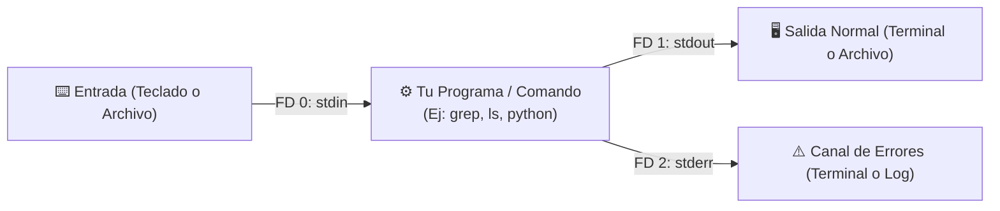

---
tags:
  - curso/modulo02
  - unix/flujos
  - redirecciones
  - pipes
  - bash/filtros
modulo: 2
tiempo_estimado: 20 min
---

# 🌊 Módulo 2: El Flujo de Datos UNIX y Redirecciones

[[01 - El Modelo Mental de la Shell de Linux|⬅️ Módulo Anterior]] • [[00 - MOC - Fundamentos de Shell Scripting|🏠 Inicio (MOC)]] • [[03 - Variables, Sintaxis y la Regla de Oro|Siguiente Módulo ➡️]]

---

## 🎯 Objetivo de este Módulo
Entender a fondo la filosofía de flujo de datos en Linux. Dominarás los tres descriptores estándar de archivos (`stdin`, `stdout`, `stderr`), el uso de redirecciones (`>`, `>>`, `<`), la tubería (`|`) y cómo conectar comandos entre sí para crear cadenas de procesamiento potentes.

---

## 1. Los 3 Canales de Comunicación Estándar

En Linux, **todo programa que se inicia nace con tres canales abiertos de comunicación**, llamados *Descriptores de Archivo* (*File Descriptors* o FD):



| Descriptor (FD) | Nombre | Canal | Origen / Destino Predeterminado |
| :---: | :--- | :--- | :--- |
| **`0`** | `stdin` | Entrada estándar | El teclado |
| **`1`** | `stdout` | Salida estándar | La pantalla de la terminal |
| **`2`** | `stderr` | Salida de error estándar | La pantalla de la terminal |

> [!tip] La Razón de Separar Salida y Errores
> Aunque ambos se muestran en tu pantalla, viajan por canales distintos. Esto permite guardar los resultados limpios de un programa en un archivo sin mezclarlo con advertencias o fallos.

---

## 2. Operadores de Redirección

Por defecto, los canales apuntan a la pantalla o teclado. Con las redirecciones, tú decides a dónde viajan los datos:

### Sobrescribir (`>`) vs Añadir al final (`>>`)
- **`>` (Sobrescribe):** Si el archivo existe, borra todo su contenido previo y escribe lo nuevo. Si no existe, lo crea.
  ```bash
  echo "Primera línea" > notas.txt    # Crea notas.txt
  echo "Segunda línea" > notas.txt    # ¡Borra la primera! Ahora solo dice "Segunda línea"
  ```
- **`>>` (Anexa / Append):** Agrega la salida al final del archivo sin tocar lo que ya existía.
  ```bash
  echo "Línea adicional" >> notas.txt  # Agrega la línea al final
  ```

### Redirección de Entrada (`<`)
En lugar de esperar que el usuario escriba en el teclado, alimenta el comando directamente desde un archivo:
```bash
wc -l < notas.txt   # Cuenta las líneas de notas.txt directamente
```

---

## 3. Manejo de Errores y el Agujero Negro: `/dev/null`

¿Cómo capturamos o silenciamos errores?

```bash
# 1. Redirigir solo los errores a un archivo de log
ls /carpeta_que_no_existe 2> errores.log

# 2. Silenciar los errores enviándolos a /dev/null
ls /carpeta_que_no_existe 2> /dev/null

# 3. Guardar salida normal en un archivo y descartar errores
nmap 192.168.1.1 > resultado.txt 2> /dev/null

# 4. Enviar TODO (salida normal Y errores) al mismo archivo
comando_pesado > salida_total.log 2>&1
# (En Bash moderno también puedes usar el atajo &>):
comando_pesado &> salida_total.log
```

> [!info] ¿Qué es `/dev/null`?
> Es un archivo especial de Linux conocido como el "agujero negro". Cualquier dato que redirijas a `/dev/null` desaparece instantáneamente sin consumir espacio en disco.

---

## 4. La Tubería (`|`): Conectando Procesos en Memoria

Una tubería toma el canal **`stdout` (1)** del comando izquierdo y lo enchufa directamente en el **`stdin` (0)** del comando derecho **en tiempo real y a través de la memoria RAM** (sin crear archivos intermedios en disco).

### Filtros Esenciales para Tuberías:
- **`grep "palabra"`**: Filtra y muestra solo las líneas que contienen esa palabra.
- **`wc -l`**: Cuenta cuántas líneas de texto llegaron.
- **`head -n 5`**: Toma solo las primeras 5 líneas.
- **`tail -n 5`**: Toma solo las últimas 5 líneas.
- **`sort`**: Ordena alfabética o numéricamente las líneas recibidas.
- **`uniq`**: Elimina líneas duplicadas consecutivas (suele usarse tras `sort`).

---

## 🧪 Laboratorio Práctico 2: El Inspector de Logs

Vamos a crear un script que analice qué usuarios han intentado iniciar sesión en el sistema usando redirecciones y tuberías.

1. Crea el archivo:
   ```bash
   nano inspector_usuarios.sh
   ```
2. Pega este código:
   ```bash
   #!/usr/bin/env bash

   REPORTE="reporte_usuarios.txt"

   echo "=== AUDITORÍA DEL SISTEMA ===" > "$REPORTE"
   echo "Generado el: $(date)" >> "$REPORTE"
   echo "-----------------------------" >> "$REPORTE"

   echo "Total de usuarios configurados en el sistema:" >> "$REPORTE"
   # Extraemos la primera columna de /etc/passwd con cut y contamos con wc
   cut -d: -f1 /etc/passwd | wc -l >> "$REPORTE"

   echo "-----------------------------" >> "$REPORTE"
   echo "Top 5 usuarios con shell interactiva (bash):" >> "$REPORTE"
   grep "/bin/bash" /etc/passwd | cut -d: -f1 | head -n 5 >> "$REPORTE"

   echo "✅ Reporte generado con éxito en '$REPORTE':"
   cat "$REPORTE"
   ```
3. Otorga permisos y ejecútalo:
   ```bash
   chmod +x inspector_usuarios.sh
   ./inspector_usuarios.sh
   ```

---

## 🧩 Checkpoint de Comprensión

> [!question]- ¿Qué hace exactamente `grep "error" /var/log/syslog | wc -l > total_errores.txt 2>/dev/null`?
> 1. `grep "error"` busca la palabra "error" en el log del sistema.
> 2. Si `grep` encuentra un permiso denegado, el `2>/dev/null` silencia ese error.
> 3. Las líneas encontradas pasan por la tubería `|` a `wc -l`, que las cuenta.
> 4. El operador `>` guarda ese número en el archivo `total_errores.txt`, sobrescribiendo cualquier contenido previo.

---

### 🚀 Siguiente Paso
Ahora que dominas cómo fluyen los datos y cómo redirigirlos, pasemos a entender las entrañas del lenguaje: variables, reglas de sintaxis y la regla de oro:
➡️ **[[03 - Variables, Sintaxis y la Regla de Oro|Módulo 3: Variables, Sintaxis y la Regla de Oro ➡️]]**
