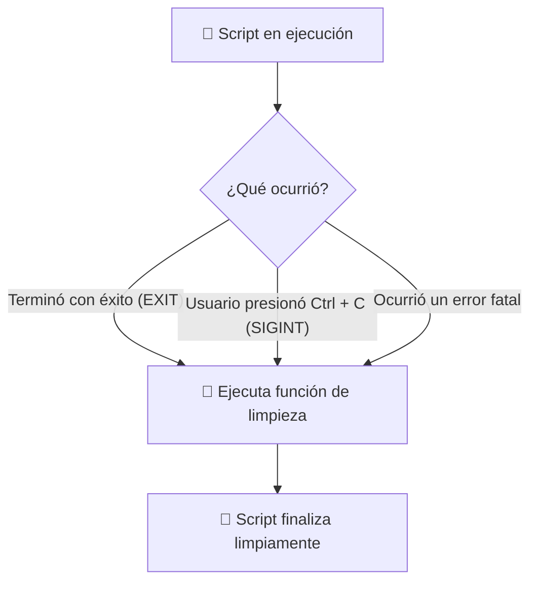

---
tags:
  - curso/modulo08
  - bash/debug
  - programacion_defensiva
  - trap
  - seguridad
modulo: 8
tiempo_estimado: 25 min
---

# 🛡️ Módulo 8: Programación Defensiva y Debug

[[07 - Funciones y Modularidad Limpia|⬅️ Módulo Anterior]] • [[00 - MOC - Fundamentos de Shell Scripting|🏠 Inicio (MOC)]] • [[09 - Proyecto Integrador - Creando tu CLI|Siguiente Módulo ➡️]]

---

## 🎯 Objetivo de este Módulo
Llevar tus habilidades al nivel de un desarrollador senior. Aprenderás a blindar tus scripts para que nunca fallen de manera catastrófica, cómo limpiar automáticamente archivos temporales con `trap` incluso si el usuario presiona `Ctrl + C`, y cómo depurar errores en tiempo real usando el modo de trazado `bash -x`.

---

## 1. El Santo Grial del Modo Estricto: `set -euo pipefail`

En scripts profesionales verás casi siempre esta línea al inicio:

```bash
set -euo pipefail
```

Desglosemos por qué esta combinación te salvará la vida:

| Bandera | Nombre | Qué hace |
| :---: | :--- | :--- |
| **`-e`** | *Exit on error* | Si cualquier comando devuelve un código de salida distinto de `0`, el script se detiene de inmediato. No continúa a ciegas. |
| **`-u`** | *Nounset* | Trata cualquier variable no declarada como un error fatal. Evita desastres como `rm -rf "$CARPETA_MAL_ESCRITA/*"`. |
| **`-o pipefail`** | *Pipe failure* | Si el primer comando de una tubería (`cmd1 | cmd2`) falla, toda la tubería devuelve error, impidiendo que los fallos queden silenciados. |

> [!warning] ¿Cómo manejar comandos que esperamos que fallen?
> Si usas `set -e` y ejecutas un `grep` que no encuentra coincidencias, `grep` devolverá código `1` y tu script se detendrá. Para permitir comandos controlados, añade `|| true`:
> ```bash
> grep "palabra" archivo.txt || true  # Continúa aunque no encuentre nada
> ```

---

## 2. Limpieza Garantizada con `trap`

Imagina que tu script crea una carpeta temporal `/tmp/escaneo_1234` con archivos confidenciales. Si el usuario presiona `Ctrl + C` a mitad del proceso o el script sufre un corte de luz, esa basura quedará para siempre en el disco.

### La Solución: El Centinela `trap`
`trap` le indica al Kernel: *"No importa cómo termine este script (con éxito, con error o interrumpido con `Ctrl + C`), ejecuta esta función de limpieza antes de morir"*:



### Código de Implementación Estándar:
```bash
# Crear directorio temporal seguro
TEMP_DIR="$(mktemp -d)"

# Función de limpieza
limpiar() {
  echo "🧹 Limpiando archivos temporales en $TEMP_DIR..."
  rm -rf "$TEMP_DIR"
}

# Registrar la trampa para las señales EXIT e INT (Ctrl+C)
trap limpiar EXIT INT TERM
```

---

## 3. Depuración Paso a Paso: El Modo Traza (`-x`)

¿Tienes un script que se comporta de forma extraña y no sabes en qué línea ocurre el error? No necesitas llenar el código de `echo "aquí voy"`.

### Activar el Trazador Visual:
Ejecuta tu script con el modificador `-x`:
```bash
bash -x mi_script.sh
```

O actívalo solo en una sección específica dentro del archivo:
```bash
echo "Código normal..."

set -x  # <-- Inicia la depuración detallada
comando_dudoso
resultado=$(( 5 * 2 ))
set +x  # <-- Detiene la depuración detallada

echo "Continúa la ejecución normal..."
```
Verás cada comando impreso en la terminal con un símbolo `+` por delante mostrando las variables ya sustituidas antes de ejecutarse.

---

## 4. El Analizador Estático: `shellcheck`

Existe una herramienta de código abierto esencial para todo estudiante y profesional llamada **`shellcheck`**:

```bash
# Instalar en Linux Mint / Ubuntu:
sudo apt install -y shellcheck

# Analizar cualquier script:
shellcheck mi_script.sh
```
`shellcheck` lee tu código y te señala advertencias de seguridad, malas prácticas, comillas faltantes o incompatibilidades antes de que ejecutes el programa.

---

## 🧪 Laboratorio Práctico 8: Blindando un Script Frágil

Vamos a tomar un script vulnerable y transformarlo en código de grado militar:

1. Crea el script blindado:
   ```bash
   nano script_blindado.sh
   ```
2. Escribe este código:
   ```bash
   #!/usr/bin/env bash
   set -euo pipefail

   # 1. Crear entorno temporal con mktemp
   DIR_TMP="$(mktemp -d -t auditoria_XXXXXX)"

   # 2. Configurar la trampa de salida
   limpiar_entorno() {
     local codigo_salida=$?
     echo ""
     echo "==========================================="
     echo "🧹 Ejecutando limpieza automática..."
     rm -rf "$DIR_TMP"
     echo "Directorio $DIR_TMP eliminado."
     echo "Script finalizado con código: $codigo_salida"
     echo "==========================================="
   }
   trap limpiar_entorno EXIT

   echo "Directorio temporal seguro creado en: $DIR_TMP"

   # 3. Simulamos trabajo pesado
   echo "Creando datos de prueba..."
   echo "Información sensible" > "$DIR_TMP/datos.txt"

   echo "Procesando... Presiona Ctrl + C en los próximos 5 segundos para probar la trampa:"
   for i in {5..1}; do
     echo -n "$i... "
     sleep 1
   done
   echo "¡Completado!"
   ```
3. Otorga permisos y pruébalo:
   ```bash
   chmod +x script_blindado.sh
   ./script_blindado.sh
   ```
4. **La Prueba de Fuego:** Ejecútalo de nuevo y presiona rápidamente `Ctrl + C` mientras cuenta. Observa cómo el script atrapa la señal y borra el directorio temporal sin dejar ningún rastro.

---

## 🧩 Checkpoint de Comprensión

> [!question]- ¿Qué hace el comando `mktemp -d -t prefijo_XXXXXX` y por qué es mejor que usar `/tmp/mi_carpeta`?
> `mktemp` genera un nombre aleatorio e irrepetible reemplazando las `X` por caracteres únicos (ej. `/tmp/prefijo_a8f9B1`) y con permisos restringidos exclusivamente a tu usuario. Usar una ruta fija como `/tmp/mi_carpeta` genera colisiones si dos usuarios o dos instancias del script se ejecutan a la vez, además de ser una vulnerabilidad de seguridad conocida como ataque por enlace simbólico (*symlink attack*).

---

### 🚀 Siguiente Paso
¡Has dominado todos los fundamentos! Ha llegado el momento de unir todas las piezas en el **Proyecto Integrador** donde construirás tu propia herramienta de línea de comandos:
➡️ **[[09 - Proyecto Integrador - Creando tu CLI|Módulo 9: Proyecto Integrador - Creando tu CLI ➡️]]**
