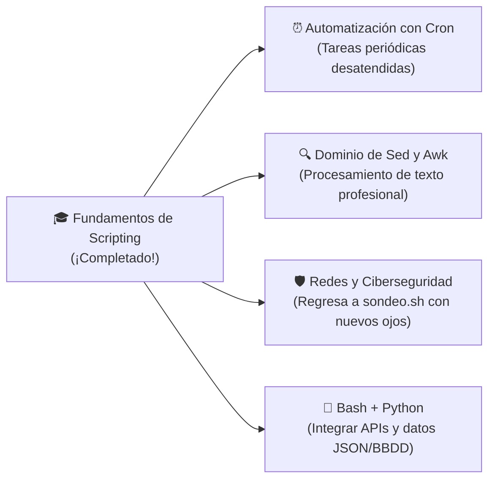

---
tags:
  - curso/modulo10
  - glosario
  - cheatsheet
  - referencia
  - roadmap
modulo: 10
tiempo_estimado: 15 min
---

# 📚 Módulo 10: Glosario Maestro y Próximos Pasos

[[09 - Proyecto Integrador - Creando tu CLI|⬅️ Módulo Anterior]] • [[00 - MOC - Fundamentos de Shell Scripting|🏠 Inicio (MOC)]] • [[11 - Desafío Maestro - Leyendo sondeo.sh con Superpoderes|Siguiente: El Final Boss ➡️]]

---

## ⚡ Chuleta Maestra de Referencia Rápida (Cheat Sheet)

### 1. Variables Especiales del Sistema

| Variable | Descripción |
| :---: | :--- |
| **`$0`** | Nombre del script invocado |
| **`$1` .. `$9`** | Argumentos posicionales del 1 al 9 |
| **`${10}`** | Argumento 10 en adelante (requiere llaves) |
| **`$#`** | Cantidad total de argumentos recibidos |
| **`"$@"`** | Todos los argumentos por separado (conserva espacios) |
| **`"$*"`** | Todos los argumentos unidos en una sola cadena |
| **`$?`** | Código de salida del último comando (`0` = éxito) |
| **`$$`** | PID (Identificador de proceso) del script en ejecución |

---

### 2. Redirecciones y Canales

| Sintaxis | Acción |
| :--- | :--- |
| `comando > archivo` | Guarda `stdout`, **sobrescribe** el archivo |
| `comando >> archivo` | Guarda `stdout`, **anexa al final** |
| `comando < archivo` | Alimenta `stdin` con el contenido del archivo |
| `comando 2> archivo` | Redirige solo el canal de errores (`stderr`) |
| `comando 2> /dev/null` | Silencia y descarta los errores |
| `comando &> archivo` | Redirige tanto la salida normal como los errores |
| `comandoA \| comandoB` | Conecta el `stdout` de A con el `stdin` de B mediante memoria |

---

### 3. Operadores de Prueba (`[[ ... ]]`)

| Tipo | Operadores | Ejemplo |
| :--- | :--- | :--- |
| **Archivos** | `-f` (archivo regular), `-d` (directorio), `-e` (existe), `-s` (no vacío), `-x` (ejecutable) | `[[ -f "/etc/passwd" ]]` |
| **Texto** | `==` (igual), `!=` (diferente), `-z` (vacío), `-n` (no vacío), `=~` (regex) | `[[ -z "$VARIABLE" ]]` |
| **Números** | `-eq` (`==`), `-ne` (`!=`), `-gt` (`>`), `-lt` (`<`), `-ge` (`>=`), `-le` (`<=`) | `[[ $EDAD -ge 18 ]]` |

---

## 📖 Glosario Técnico de Términos

### Shebang (`#!`)
Par de caracteres al inicio de un script (`#!/usr/bin/env bash`) que le indica al kernel de Linux qué programa intérprete debe ejecutar el archivo.

### Código de Salida (Exit Status)
Número entero entre 0 y 255 que todo programa en Linux devuelve al terminar. En la filosofía UNIX, `0` indica ejecución perfecta y cualquier valor del 1 al 255 indica un error específico.

### Subshell
Instancia secundaria de Bash generada temporalmente para ejecutar un bloque entre paréntesis `( ... )` o una sustitución de comando `$( ... )`. Las variables modificadas dentro de una subshell no alteran el entorno del proceso padre.

### Globbing
Expansión automática de nombres de archivos que realiza la shell mediante comodines como `*` (cualquier texto) o `?` (un solo carácter), por ejemplo `*.txt`.

### Trap (Trampa de Señales)
Mecanismo de Bash para interceptar señales del sistema operativo (como `SIGINT` cuando el usuario pulsa `Ctrl + C` o `EXIT` al terminar) y ejecutar código de limpieza antes de finalizar.

---

## 🗺️ Tu Próxima Frontera de Aprendizaje

¡Has completado los fundamentos de Shell Scripting con éxito! Ahora tienes la base sólida para explorar áreas más avanzadas:

1. **Vuelve a mirar [[sondeo.sh]]:**  
   Ahora que entiendes el Shebang, `set -uo pipefail`, `awk`, tuberías, variables y funciones, ¡notarás que puedes leer y modificar ese script de red con total soltura!
2. **Tareas Programadas con `cron`:**  
   Aprende a ejecutar tu herramienta `syssentry` todos los días a las 3:00 AM usando `crontab -e`.
3. **Control de Versiones con Git:**  
   Crea tu propio repositorio en GitHub para guardar tus scripts y utilizarlos en cualquier máquina Linux donde trabajes.

---

### 🚀 Tu Prueba de Fuego Final
➡️ Pasa al desafío final: **[[11 - Desafío Maestro - Leyendo sondeo.sh con Superpoderes|Módulo 11: El Final Boss ('sondeo.sh') ➡️]]**

Volver al **[[00 - MOC - Fundamentos de Shell Scripting|Mapa de Contenido Principal (MOC) 🏠]]**.
