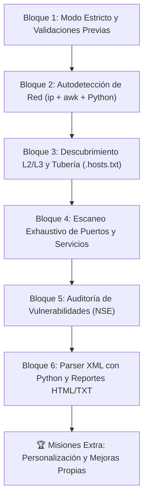

# 🛠️ Guía de Construcción Paso a Paso: El Proyecto Final Boss

> *"Un scripter novato ejecuta scripts creados por otros. Un scripter avanzado sabe exactamente cómo ensamblar cada pieza desde cero."*

Bienvenido al tutorial de construcción guiado del **Final Boss**. En lugar de entregarte un código cerrado de 257 líneas para que lo mires pasivamente, en esta guía vamos a **ensamblar la herramienta bloque a bloque con tus propias manos**, utilizando todo lo aprendido a lo largo de la academia.

---

## 🗺️ Mapa de Construcción en 6 Bloques



---

## 📋 Lista de Verificación de tu Proyecto

Abre este documento en Obsidian o tu editor para ir marcando tu progreso:
- [ ] **Bloque 1:** Entorno Seguro, Colores y Validación de Privilegios
- [ ] **Bloque 2:** Detección Dinámica de Tarjeta y Subred CIDR
- [ ] **Bloque 3:** Censo de Dispositivos Activos (ARP + ICMP) y Tubería UNIX
- [ ] **Bloque 4:** Escaneo de Puertos (-p-), Servicios (-sV) y SO (-O)
- [ ] **Bloque 5:** Auditoría de Vulnerabilidades con Nmap NSE
- [ ] **Bloque 6:** Extracción de Datos en Python y Generación de Reportes Web
- [ ] **Reto Extra:** Añadir cronómetro `$SECONDS` y modo rápido `--fast`

---

## 🧱 Bloque 1: El Esqueleto Defensivo y Chequeos Previos

### 🎯 Objetivo
Garantizar que el script sea seguro, informe de errores inmediatamente y verifique que el sistema cuenta con permisos de superusuario y los programas instalados antes de hacer nada.

### 💡 Conceptos Aplicados
- `set -uo pipefail` *(Módulo 8)*: Modo escudo contra variables vacías y fallos en tuberías.
- Variables protegidas y timestamps `$(date +%Y%m%d_%H%M%S)` *(Módulo 3)*.
- Funciones de registro con colores ANSI *(Módulo 7)*.
- Validación de root con `$EUID -ne 0` *(Módulo 3 y 5)*.
- Comprobación de binarios con `command -v` silenciado con `>/dev/null 2>&1` *(Módulo 2 y 3)*.

### 🛠️ Código del Bloque 1
```bash
#!/usr/bin/env bash
set -uo pipefail

# 1. Configuración y marcas de tiempo
SUBNET=""
VULNERS_API_KEY=""
OUTBASE="$HOME/escaneos"
STAMP="$(date +%Y%m%d_%H%M%S)"
OUTDIR="$OUTBASE/scan_$STAMP"

# 2. Paleta de colores ANSI y funciones
C_OK="\033[1;32m"; C_INFO="\033[1;34m"; C_WARN="\033[1;33m"; C_ERR="\033[1;31m"; C_RST="\033[0m"
log()  { echo -e "${C_INFO}[*]${C_RST} $*"; }
ok()   { echo -e "${C_OK}[+]${C_RST} $*"; }
warn() { echo -e "${C_WARN}[!]${C_RST} $*"; }
err()  { echo -e "${C_ERR}[x]${C_RST} $*"; }

# 3. Comprobar que somos superusuario (root)
if [[ $EUID -ne 0 ]]; then
  err "Ejecuta como root: sudo $0"
  exit 1
fi

# 4. Validar herramientas necesarias
for bin in nmap arp-scan xsltproc python3; do
  if ! command -v "$bin" >/dev/null 2>&1; then
    err "Falta '$bin'. Instala con: sudo apt install -y nmap arp-scan xsltproc python3"
    exit 1
  fi
done

# 5. Crear directorio de trabajo
mkdir -p "$OUTDIR" || { err "No pude crear $OUTDIR"; exit 1; }
ok "Entorno preparado en: $OUTDIR"
```

### 🧪 Cómo Probarlo
Ejecuta sin `sudo`: debe abortar diciendo `Ejecuta como root`. Ejecuta con `sudo`: debe imprimir el mensaje verde `[+] Entorno preparado`.

---

## 🧱 Bloque 2: Autodetección de Subred (Bash + Python)

### 🎯 Objetivo
Detectar automáticamente por qué tarjeta de red salimos a Internet y calcular la subred local (ej. `192.168.1.0/24`) sin obligar al usuario a escribirla a mano.

### 💡 Conceptos Aplicados
- `ip route show default` con filtro de columna `awk '{print $5; exit}'` *(Módulo 2 y 4)*.
- Here-Document `<<PY ... PY` inyectando código Python por `stdin` para usar la librería estándar `ipaddress` *(Módulo 4)*.

### 🛠️ Código del Bloque 2
```bash
if [[ -z "$SUBNET" ]]; then
  # Extraer la interfaz por defecto (ej: wlan0 o eth0)
  IFACE="$(ip route show default | awk '{print $5; exit}')"
  if [[ -z "${IFACE:-}" ]]; then
    err "No detecté interfaz de red. Fija SUBNET manualmente."
    exit 1
  fi

  # Extraer la IP con máscara CIDR (ej: 192.168.1.45/24)
  IP_CIDR="$(ip -4 -o addr show dev "$IFACE" | awk '{print $4; exit}')"

  # Calcular la red base mediante Python embebido
  SUBNET="$(python3 - <<PY
import ipaddress
print(ipaddress.ip_interface("$IP_CIDR").network)
PY
)"
  ok "Interfaz: $IFACE  ->  Subred calculada: $SUBNET"
else
  ok "Subred fijada manualmente: $SUBNET"
fi
```

---

## 🧱 Bloque 3: Descubrimiento L2/L3 y Tubería de Filtrado

### 🎯 Objetivo
Encontrar todas las máquinas vivas en la red y generar una lista limpia y ordenada numéricamente llamada `.hosts.txt`.

### 💡 Conceptos Aplicados
- Capa 2 con `arp-scan` (inmune a firewalls locales) + Capa 3 con `nmap -sn` *(Módulo 5)*.
- Agrupación de salidas `{ cmd1 ; cmd2 ; }` canalizadas por un pipe `|` *(Módulo 2)*.
- Expresión regular `awk '/^[0-9]+\.[0-9]+/ {print $1}'` *(Módulo 2)*.
- Ordenamiento numérico octeto por octeto con `sort -u -t. -k1,1n -k2,2n -k3,3n -k4,4n` *(Módulo 2 y 5)*.
- Conteo con redirección `<` y `wc -l` *(Módulo 2)*.

### 🛠️ Código del Bloque 3
```bash
log "Fase 1/3 - Descubriendo dispositivos en $SUBNET ..."
DISCOVERY="$OUTDIR/01_descubrimiento.txt"

# Lanzar sondeos L2 y L3
arp-scan --localnet > "$DISCOVERY" 2>/dev/null || true
nmap -sn "$SUBNET" -oG "$OUTDIR/.ping.gnmap" >/dev/null 2>&1 || true

# Tubería de extracción y ordenamiento
{
  awk '/^[0-9]+\.[0-9]+\.[0-9]+\.[0-9]+/ {print $1}' "$DISCOVERY" 2>/dev/null
  awk '/Status: Up/ {print $2}' "$OUTDIR/.ping.gnmap" 2>/dev/null
} | sort -u -t. -k1,1n -k2,2n -k3,3n -k4,4n > "$OUTDIR/.hosts.txt"

HOSTCOUNT=$(wc -l < "$OUTDIR/.hosts.txt")
if [[ "$HOSTCOUNT" -eq 0 ]]; then
  warn "No se encontraron dispositivos activos."
  exit 0
fi
ok "Dispositivos activos encontrados: $HOSTCOUNT"
```

---

## 🧱 Bloque 4: Escaneo Exhaustivo de Puertos, Servicios y SO

### 🎯 Objetivo
Interrogar a cada uno de los dispositivos descubiertos para saber qué puertos tienen abiertos, qué programas escuchan y qué sistema operativo utilizan.

### 💡 Conceptos Aplicados
- Banderas de Nmap: `-Pn` (sin ping previo), `-sS` (SYN sigiloso), `-sV` (versiones de servicios), `-O` (detección de SO), `-p-` (los 65,535 puertos), `--min-rate 1000` (aceleración) y `-oA` (salida en normal, grepable y XML).
- Lectura de objetivos desde archivo con `-iL`.

### 🛠️ Código del Bloque 4
```bash
log "Fase 2/3 - Escaneando puertos y servicios (esto tardará unos minutos)..."
PORTS_SCAN="$OUTDIR/02_puertos_servicios"

nmap -Pn -sS -sV -O --osscan-guess \
     -p- --min-rate 1000 \
     --script=banner \
     -iL "$OUTDIR/.hosts.txt" \
     -oA "$PORTS_SCAN" \
     --host-timeout 20m >/dev/null 2>&1

ok "Escaneo de puertos completado."
```

---

## 🧱 Bloque 5: Auditoría Automatizada de Vulnerabilidades (NSE)

### 🎯 Objetivo
Ejecutar scripts automatizados de auditoría para verificar si las versiones detectadas tienen fallos de seguridad o exploits conocidos.

### 💡 Conceptos Aplicados
- Condicional para comprobar si el usuario definió una API key: `if [[ -n "$VULNERS_API_KEY" ]]` *(Módulo 5)*.
- Motor de scripts NSE con categoría `vuln`.

### 🛠️ Código del Bloque 5
```bash
log "Fase 3/3 - Analizando vulnerabilidades con NSE (vuln)..."
VULN_SCAN="$OUTDIR/03_vulnerabilidades"
NSE="vuln"

if [[ -n "$VULNERS_API_KEY" ]]; then
  NSE="vuln,vulners"
  ok "API Key de Vulners detectada: auditoría enriquecida."
else
  warn "Sin API Key de Vulners: usando solo scripts estándar 'vuln'."
fi

nmap -Pn -sV \
     --script="$NSE" \
     -p- --min-rate 1000 \
     -iL "$OUTDIR/.hosts.txt" \
     -oA "$VULN_SCAN" \
     --host-timeout 25m >/dev/null 2>&1

ok "Análisis de vulnerabilidades completado."
```

---

## 🧱 Bloque 6: Extracción de Datos (Parsing XML) y Generación de Reportes

### 🎯 Objetivo
Transformar los datos estructurados en XML generados por Nmap en dos entregables profesionales: un archivo legible en texto plano (`REPORTE.txt`) y una página web estilizada con tema oscuro (`REPORTE.html`).

### 💡 Conceptos Aplicados
- Here-Doc seguro `<<'PY'` con comillas para que Bash no expanda variables dentro del script de Python *(Módulo 4 y 7)*.
- Librería `xml.etree.ElementTree` para recorrer los nodos `<host>`, `<port>` y `<script>`.
- Here-Doc de HTML con sanitización de caracteres `<`, `>` y `&` usando `sed` *(Módulo 2)*.

### 🛠️ Código del Bloque 6
```bash
log "Generando reportes finales..."
REPORT_TXT="$OUTDIR/REPORTE.txt"
REPORT_HTML="$OUTDIR/REPORTE.html"

# Parser de XML en Python
python3 - "$PORTS_SCAN.xml" "$VULN_SCAN.xml" "$REPORT_TXT" "$SUBNET" "$HOSTCOUNT" <<'PY'
import sys, xml.etree.ElementTree as ET
from datetime import datetime

ports_xml, vuln_xml, out_txt, subnet, hostcount = sys.argv[1:6]

def parse(xmlfile):
    tree = ET.parse(xmlfile)
    root = tree.getroot()
    hosts = []
    for h in root.findall("host"):
        if h.find("status").get("state") != "up":
            continue
        addr = h.find("address").get("addr")
        hostname = ""
        hn = h.find("hostnames/hostname")
        if hn is not None:
            hostname = hn.get("name","")
        ports = []
        for p in h.findall("ports/port"):
            if p.find("state").get("state") != "open":
                continue
            svc = p.find("service")
            name = svc.get("name","?") if svc is not None else "?"
            prod = svc.get("product","") if svc is not None else ""
            ver  = svc.get("version","") if svc is not None else ""
            scripts = [(s.get("id"), s.get("output","")) for s in p.findall("script")]
            ports.append((p.get("portid"), p.get("protocol"), name, prod, ver, scripts))
        hosts.append((addr, hostname, ports))
    return hosts

try:
    hosts = parse(ports_xml)
except Exception:
    hosts = []

# Guardar en texto estructurado
lines = []
w = lines.append
w("="*70)
w("  REPORTE CONSOLIDADO DE AUDITORÍA DE RED")
w("="*70)
w(f"Fecha       : {datetime.now().strftime('%Y-%m-%d %H:%M:%S')}")
w(f"Subred      : {subnet}")
w(f"Dispositivos: {hostcount}")
w("="*70)
w("")

for addr, hostname, ports in hosts:
    w(f"HOST: {addr} {f'({hostname})' if hostname else ''}")
    w("-"*70)
    if not ports:
        w("  Sin puertos abiertos detectados.")
    for pid, proto, name, prod, ver, scripts in ports:
        w(f"  [{proto}/{pid}] {name} {prod} {ver}".rstrip())
    w("")

open(out_txt,"w").write("\n".join(lines))
PY

# Generación del HTML oscuro
cat > "$REPORT_HTML" <<HTML
<!DOCTYPE html><html lang="es"><head><meta charset="utf-8">
<title>Reporte de escaneo $STAMP</title>
<style>
body{font-family:monospace;background:#111;color:#ddd;padding:20px}
h1{color:#4fc3f7} h2{color:#81c784;border-bottom:1px solid #333}
pre{background:#1a1a1a;padding:12px;border-radius:6px;overflow-x:auto}
</style></head><body>
<h1>Auditoría de Red - Final Boss</h1>
<p>Subred: <b>$SUBNET</b> | Fecha: $STAMP | Dispositivos: $HOSTCOUNT</p>
<h2>Detalle de Resultados</h2>
<pre>$(sed 's/&/\&amp;/g; s/</\&lt;/g; s/>/\&gt;/g' "$REPORT_TXT")</pre>
</body></html>
HTML

ok "¡Misión cumplida! Reporte listo."
echo -e "${C_OK}Reporte Web :${C_RST} $REPORT_HTML"
echo "Abre con: xdg-open \"$REPORT_HTML\""
```

---

## 🏆 Desafíos de Personalización (Tus Propias Mejoras)

Una vez que tengas el esqueleto funcionando, dale tu sello personal con lo aprendido en el curso:

1. **Añade un cronómetro de duración:** Agrega `SECONDS=0` en el Bloque 1 y calcula `$(( SECONDS / 60 ))` al final *(Módulo 3)*.
2. **Crea un selector de modo rápido:** Si pasas `--fast` como argumento `$1`, haz que Nmap escanee `--top-ports 100` en vez de `-p-` *(Módulo 4 y 5)*.
3. **Notificación al celular:** Envía un mensaje con `curl` a un Webhook de Discord o Telegram cuando el escaneo finalice *(Módulo 2 y 7)*.
