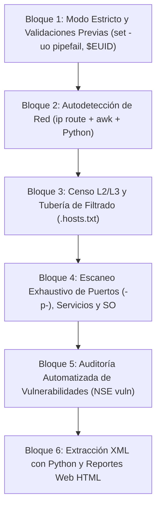

# 👾 Proyecto Final: El "Final Boss" — Construye tu propio Escáner de Red

> *"Este es el proyecto integrador definitivo de la academia. Aquí no solo ejecutarás código: vas a construir, entender, debugear y personalizar una herramienta real de auditoría de red bloque a bloque."*

---

## 🎯 La Filosofía de este Proyecto

En lugar de ser un simple repositorio estático con un script terminado, este directorio es un **taller de construcción guiado**.

Aquí encontrarás 3 archivos diseñados para tu aprendizaje:

| Archivo | Rol | Descripción |
| :--- | :---: | :--- |
| 📘 **[[GUIA_CONSTRUCCION|GUIA_CONSTRUCCION.md]]** | **El Manual** | Guía didáctica paso a paso que te explica cómo programar cada uno de los **6 bloques** del script y el porqué de cada decisión técnica. |
| 🛠️ **[[esqueleto_starter.sh]]** | **Tu Lienzo** | Plantilla de código con estructura lista, comentarios didácticos y tareas `TODO` para que ensambles la herramienta con tus propias manos. |
| 🛡️ **[[sondeo.sh]]** | **La Solución** | El script terminado y pulido al 100%, para usar como referencia si te trabas o para comparar tu resultado final. |

---

## 🧱 Los 6 Bloques de Construcción



---

## 🚀 Ruta de Trabajo Sugerida

1. **Lee la guía paso a paso:** Abre **[[GUIA_CONSTRUCCION|GUIA_CONSTRUCCION.md]]**.
2. **Abre la plantilla:** Edita **[[esqueleto_starter.sh]]**.
3. **Prueba cada bloque en la terminal:**
   ```bash
   sudo ./esqueleto_starter.sh
   ```
4. **Compara con la solución:** Si tienes dudas con alguna sintaxis compleja (como el parser de XML o el Here-Doc de subredes), consulta **[[sondeo.sh]]**.
5. **Añade tus propias mejoras:** Agrega un temporizador con `$SECONDS` o un modo rápido `--fast`.

---

## 📦 Dependencias Necesarias

Para que la herramienta funcione en tu sistema (Debian / Ubuntu / Linux Mint), asegúrate de tener instalados los binarios:

```bash
sudo apt update
sudo apt install -y nmap arp-scan xsltproc python3
```

---

## 🐛 Guía de Depuración (Debug del Boss)

Aprender a debugear scripts avanzados es una de las habilidades más valiosas que adquirirás:

- **Modo Traza Visual:** Para ver cada variable sustituida y cada comando en tiempo real:
  ```bash
  sudo bash -x ./esqueleto_starter.sh
  ```
- **Linter Estático:** Para verificar si dejaste variables sin comillas o errores de sintaxis antes de ejecutar:
  ```bash
  shellcheck ./esqueleto_starter.sh
  ```

---

## ⚠️ Advertencia y Uso Ético

> [!CAUTION]
> El escaneo de puertos sin autorización explícita puede constituir un delito en muchas jurisdicciones. Utiliza esta herramienta **únicamente** en redes domésticas de tu propiedad, entornos de laboratorio controlados o bajo autorización previa por escrito del administrador de la red.
